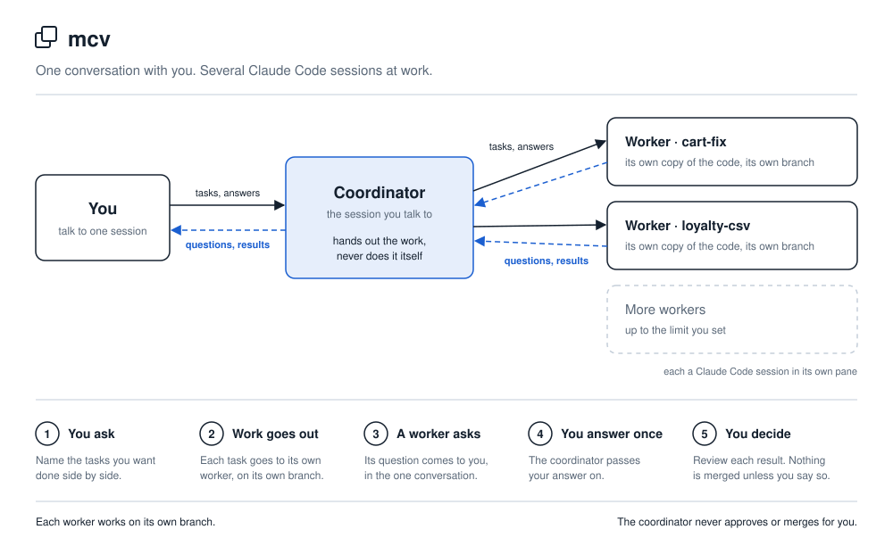
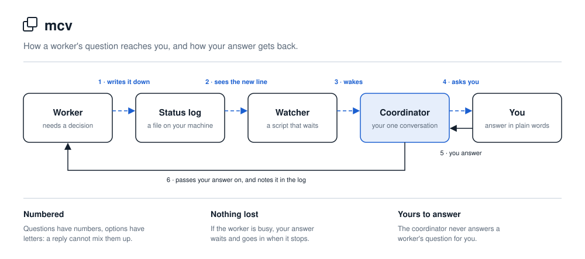
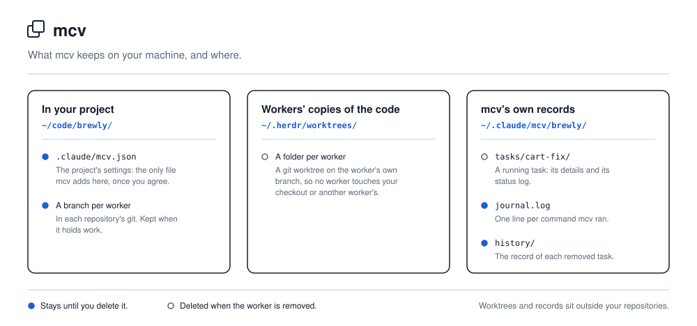

# mcv

> **Early: in daily use on two projects.** Between 8 and 17 November 2026 mcv ran more than a
> hundred workers on two real projects, most of them from a task to a merge request, and every
> release since 0.2.1 comes from what those runs showed (see the [changelog](CHANGELOG.md)). It
> has been used by one person, on macOS with herdr 0.9.5 only. Expect rough edges.

mcv lets you run several Claude Code sessions on one project at once, while you talk to only one of
them.



You work in one Claude Code session, the **coordinator**. When a task can run on its own, the
coordinator starts a **worker**: another Claude Code session, in its own git worktree on its own
branch, so workers never touch your checkout or each other's. A worker asks its questions by writing
them to a **status log**; a **watcher** script notices new lines there, and notices when a worker
stops, and wakes the coordinator, which asks you and sends your answer back.

mcv stands for Multi-session Coordination Vantage.

## Who it is for

- You already split work into tasks that can run side by side (two bugs, a feature and its tests).
- You want those tasks to run in parallel without opening and watching several terminals yourself.
- You want each task isolated on its own branch, and every question from every task in one place.

Not for: a single task (just use Claude Code), or work that needs results passed between tasks as they
run (use Claude Code subagents inside one session).

## What you need

- **herdr** >= 0.9.5 ([herdr.dev](https://herdr.dev)). herdr is a terminal workspace manager built
  for coding agents: it runs each agent in its own terminal pane, creates git worktrees, and lets a
  script start an agent, send it a prompt, read its screen, and see whether it is busy, waiting for
  approval, or finished. mcv does all of that through herdr. Tested with herdr 0.9.5.
- **herdr's Claude integration**, which is how herdr tells whether a Claude session is busy or
  finished. Install or refresh it with `herdr integration install claude`; `herdr integration status`
  must show `claude: current`. Updating herdr does not refresh it, so run the install again after
  every herdr update.
- **Claude Code runs inside herdr.** Start herdr (run `herdr` in a terminal), then start Claude Code in
  one of its panes. Every `mcv-herdr.sh` command, `doctor` included, refuses to run from a plain
  terminal, so `/mcv` does too.
- `jq` 1.5 or newer, `git` 2.17 or newer, and bash 3.2 or newer. Written on macOS (stock bash
  3.2); the whole test suite also passes on Ubuntu 24.04 (bash 5.2, git 2.43, jq 1.7; run
  2026-11-17), and the main commands were checked with jq 1.5 and git 2.17. Running the tests needs git 2.28 or newer, and perl. herdr itself is tested only on
  macOS here.

## Install

```
/plugin marketplace add G3Ner8/mcv
/plugin install mcv@mcv
```

This repository is its own marketplace. While it is private, the machine needs git access to it
(the same access `git clone` would need). Update later with `/plugin marketplace update mcv`.

## Use it

In a Claude Code session started inside a herdr pane, in your project's folder, type `/mcv` (the
slash menu shows it as `/mcv:mcv`). The first time, the coordinator checks herdr, proposes a project
config, and writes `.claude/mcv.json` once you agree. This happens even when you type the work
straight after the command (`/mcv fix the cart total`): the work waits for the config, then
comes up for your yes without your typing it again. The examples in this README follow one
made-up project, Brewly, a coffee shop's ordering system: a folder `~/code/brewly` with its own
`CLAUDE.md` and `plans/`, holding three repositories, `web` (the customer ordering site), `api`
(orders and menu) and `staff` (the baristas' order queue). Started in `~/code/brewly`, the
coordinator proposes:

```json
{ "project":  "brewly",
  "repos":    { "web": "web", "api": "api", "staff": "staff" },
  "dispatch": "{task}",
  "base":     "origin/develop",
  "context":  "." }
```

`project` is a short name that prefixes every worker; `repos` are the repositories workers may be
started in; `dispatch` is the text a new worker receives, with `{task}` replaced by its task.
Optional fields:

- `base`, for example `origin/develop`: where worker branches start. Without it they start from the
  remote's default branch, which on many projects is `main` while work starts from `develop`; the
  coordinator proposes it when it sees that.
- `context`, for example `"."`: a folder workers may read, for a project folder that holds several
  repositories. See [What a worker has](#what-a-worker-has).
- `max_workers` (default 2): how many workers run at once; the coordinator queues the rest.

A repository whose settings differ from the rest gets an object instead of a path, and its own
`base` or `context` wins over the top-level one; `"context": ""` gives it none. Say Brewly's
`staff` app still branches from `origin/main` and needs nothing from the project folder:

```json
"repos": { "web": "web",
           "api": "api",
           "staff": { "path": "staff", "base": "origin/main", "context": "" } }
```

Paths are relative to the project folder, or absolute.

Then ask for work in plain words ("the cart total in web ignores the oat-milk surcharge, fix it; and
add a CSV export of loyalty points to api"). The coordinator never picks work for you: started
with `/mcv` alone, it asks what to do. Before starting anything, it shows each worker it plans,
with its task id, repo and branch, and waits for your yes, in a message of its own; agreeing to
the config does not start a worker. Questions arrive labelled by task, for example
`cart-fix #1`; answer in plain words. The coordinator never answers a worker's question or
approves a worker's dialog for you.

Each session opens with one line naming the version it runs, for example
`⧉ mcv 0.2.4 · brewly · herdr 0.9.5 · 0 workers`. A session keeps the version it started with:
after `/plugin marketplace update mcv`, start a new session to use the new one.

Run mcv in a session of its own. Every event a worker sends makes the coordinator read its whole
conversation again, so what it costs follows the size of that conversation, not the number of
workers. Measured on a real project: a coordinator started after three hours of planning in the
same session carried 372K to 652K tokens of context and cost 35% of the run; an earlier run that
averaged 147K cost 21%. Plan, edit trackers and cut releases in another session. Between batches
of work, once every worker is removed, no question is open and nothing waits in the queue,
`/clear` the coordinator and type `/mcv` again: tasks, logs and the watcher's place are kept on
disk, but the queue and the questions already shown live only in the conversation. The watcher
the old conversation left running is replaced by the new one's.

Everything mcv shows you starts with `⧉`, so it stands out in a busy session:

> **⧉ cart-fix · QUESTION #1** · web · `fix/cart-total`
>
> **Add the surcharge per drink, or once per order?**
>
> The old code added it once; the till prints it per drink.
>
> - **a** ★ per drink → the total matches the receipt
> - **b** once per order → simpler, but differs from the till
>
> The worker recommends **a**
>
> Reply `cart-fix #1 a`

Every card reads the same way: who is asking on the first line, the question alone in bold, the
options with what follows from each, and on the last line what to type. A finished task comes as
a card too, saying the result, what the worker checked and what is left for you.



Questions have numbers and options have letters, so a reply cannot mix them up. If the
conversation has moved on from a card before you answer it, the coordinator says back what it
will send and waits for your yes. A worker's progress notes, and the waits it announces while a
build or a sub-agent runs, do not interrupt you; ask where things stand to see them. Something
you tell a worker while it is busy ("push it") is queued and goes in when it next stops.

If your terminal font has no `⧉` and shows a box instead, mcv still works; the mark is only
there to catch the eye.

## Run the helper by hand

Everything the coordinator does goes through `bin/mcv-herdr.sh`, which you can also run yourself
when a run goes wrong or you want to see what the coordinator sees. It is not on your `PATH`;
find the installed copy with `find ~/.claude/plugins/cache/mcv -name mcv-herdr.sh` and call the
newest by its full path, written `H` here:

```
H doctor                                     # herdr, its server, the integration, jq; prints mcv's version
H spawn brewly cart-fix ~/code/brewly/web fix/cart-total
                                             # new worktree on new branch fix/cart-total, idle Claude in it
H prompt brewly/cart-fix "The cart total ignores the oat-milk surcharge; fix it"
H read brewly/cart-fix                       # what the worker said
H agents                                     # every herdr agent and its state
H remove brewly/cart-fix                     # close it; keeps the branch if it holds work
```

[docs/commands.md](docs/commands.md) describes each command: what it accepts, what it refuses
and why, and what to do when one fails. Three things are worth knowing before you need that page:

- **A worker that will not start** is usually at Claude's folder trust dialog, which appears
  until "Yes" has been picked once for the repository. Pick "Yes" in the worker's herdr pane.
- **`remove` keeps a branch that holds work** and refuses a worktree with uncommitted or
  untracked files. Files your `.gitignore` ignores are deleted with the worktree.
- **Closing a repository's workspace in herdr closes the workers under it.**

## What a worker has

A worker's worktree is made from git, under `~/.herdr/worktrees/`, so it starts with what is
committed on its base branch and nothing else.

| | In the worker |
|---|---|
| The repo's committed files, including its `CLAUDE.md`, `.claude/skills`, `.claude/agents`, `.claude/settings.json` | yes, as they are on the base branch (a skill only on your local branch is missing) |
| Your own `~/.claude/` (personal `CLAUDE.md`, plugins, user-level MCP servers) | yes |
| The repo's Claude Code memory | yes, shared with the main checkout |
| Files git ignores (`.env`, `qa/.env`, the repo's own `CLAUDE.local.md`) | only those listed in the repo's `.worktreeinclude` (below) |
| `node_modules` and other installed dependencies | no: the worker installs them (`npm ci` and the like) |
| The project folder around the repo: its `CLAUDE.md`, `CLAUDE.local.md`, skills, plans | only with `context` in the config (below) |
| A path that leaves the repo, such as `../api/openapi.yaml` written in `web`'s notes | no: from a worktree it points elsewhere; the coordinator gives such paths in full in the task |
| `.claude/settings.local.json` (permissions you allowed locally) | only if listed in `.worktreeinclude` |

**`.worktreeinclude`.** A file at the repo's root, in `.gitignore` syntax, naming ignored files to
copy into every new worktree from the main checkout. Brewly's `web` keeps a test customer's login
for its browser checks in an ignored `qa/.env`, so its `.worktreeinclude` reads:

```
qa/.env
.env.development.local
```

`spawn` copies a file only when it matches a line, is a regular file (not a symlink), and the
worktree's own git ignores it and has no file there yet. The worktree is on the base branch, which
may track or not ignore a file your checkout ignores; such a file is left alone, so a secret never
overwrites committed content or turns up as a new file for `git add -A`. It is the same file Claude
Code reads for its own worktrees, so one list serves both. It is for a few small files: more than
100 matches and `spawn` stops; dependencies are installed, not copied.

**`context`.** When `.claude/mcv.json` sits in a folder that holds several repositories, a worker
in one of them loses that folder's `CLAUDE.md`, `CLAUDE.local.md` and skills, because its worktree
lives elsewhere: a worker in `brewly/web` would not see `brewly/CLAUDE.md` or `brewly/plans/`.
With `"context": "."` the worker is started with that folder added (Claude's
`--add-dir`, with `CLAUDE_CODE_ADDITIONAL_DIRECTORIES_CLAUDE_MD=1`), so it reads them as a session
opened in the repo's own folder would. `--add-dir` would also let it edit there, so the worker's
settings deny Claude's file-editing tools anywhere in that folder (checked: an edit there is
refused), and its rules tell it to treat the folder as read-only; a shell command could still write
there, as in any session. `spawn` refuses a context inside the repository, `/`, and one that holds
the worker's own worktree (your home folder, for instance). Leave it out
when that folder's notes are too broad for a single task; the coordinator then puts what the worker
needs into the task text.

## Permissions

herdr starts each worker as a new Claude Code process with only the arguments `spawn` passes, so a
worker takes its permission mode from your Claude Code settings files, not from the flags you started
your own session with. If your settings default to auto mode, workers run in auto mode, with no one
watching them.

To make a worker ask before acting, pass Claude's own flag after `--`:

```
H spawn brewly cart-fix ~/code/brewly/web fix/cart-total -- --permission-mode default
```

Such a worker stops at each approval dialog. The coordinator tells you which worker is waiting and
what the dialog asks, and never answers it: switch to the worker's herdr pane and approve or deny
there.

`spawn` refuses two of Claude's flags after `--`, in both the `--flag value` and `--flag=value`
forms: `--add-dir`, which would let the worker edit a folder outside the deny rule that keeps a
context read-only (use `context` for a folder the worker should read), and `--settings`, which
could override the `MCV_TASK` that ties the worker to its task. mcv's own `--base` and `--context`
go before `--` and are refused after it.

## Git rules for workers

Every worker is told two sets of git rules when it starts.

Always, whatever the project says:
- work only on its own branch; never commit to, push to or merge into any other branch, and never
  to `main`, `master`, `develop` or a protected branch;
- never force-push (`--force-with-lease` on its own branch only);
- never commit secrets.

The first two are also enforced. A hook checks each shell command a worker runs and refuses, before
it runs, a git command that pushes to any branch but the worker's own, force-pushes, or deletes or
moves another branch or a tag (`git push origin develop`, `git push -f`, `git branch -D main`,
`git tag -d v1.0`). The worker is told why and to ask you instead. This matters because a worker
in auto mode runs unattended, and every worktree shares the repository's branches with your own
checkout. The hook reads the command's text, so it catches mistakes, not a worker set on getting
around it: a script or an alias hides the command. For a branch that must never be pushed to,
protect it on the server as well.

Everything else follows the project's own git rules (its `CLAUDE.md` or `CONTRIBUTING`), which win.
Where a project says nothing, the worker uses common practice: small Conventional Commits, the
project's tests and linters before committing, a rebase onto the latest base branch, and at the end a
push of its own branch and a **draft** pull or merge request for a person to review.

Your own Claude Code rules apply to workers too, since they run as you: if your `CLAUDE.md` says never
to push without being told, workers will not push.

## How it fits together

- herdr does the process work: creating worktrees, starting Claude, sending prompts, reporting each
  session's state.
- mcv keeps the bookkeeping: which task each worker has, its questions and your answers.
- A worker is marked by the environment variable `MCV_TASK=<project>/<id>`, set only in that worker's
  Claude process. mcv's hooks act only when `MCV_TASK` names a task mcv started, so installing mcv
  does not change your other Claude Code sessions.

## What mcv writes



- **In your project:** only `.claude/mcv.json`, once you agree to it. If that folder is a git
  repository where the file is not ignored, the coordinator offers to ignore it for you on this
  machine (`.git/info/exclude`), without touching the project's `.gitignore`.
- **In each repository's git:** a branch per worker, which `remove` keeps if it holds work; and `origin/HEAD`, which
  `spawn` sets from the remote (`git remote set-head --auto`, as `git clone` does).
- **Elsewhere on your machine:** task state in `~/.claude/mcv/`, worktrees in `~/.herdr/worktrees/`.
  `remove` deletes both, and the folders it leaves empty, but keeps the task's record (below).
- **A record of each run,** in `~/.claude/mcv/<project>/`, kept until you delete it: `journal.log`,
  one line per `spawn`, `prompt` and `remove`, done or refused with the reason, plus notes the
  coordinator adds when something goes wrong; and `history/<task>-<time>/`, where `remove` copies
  the task's details, its status log and the paths of its worker's Claude session logs. Look there
  when a run went wrong. The session logs themselves stay Claude Code's, which deletes them after
  `cleanupPeriodDays` in your settings (30 days unless set), so an older path may point at nothing.
- **Left behind, not mcv's to delete:** the herdr workspace opened for a repository's main
  checkout, and each worker's Claude session log in `~/.claude/projects/`.

## Documentation

- [docs/commands.md](docs/commands.md): every command of the helper scripts, for running them
  by hand.
- [docs/architecture.md](docs/architecture.md): the parts, the state they keep, the rules they
  hold, and the herdr behaviour mcv relies on.
- [docs/adr/](docs/adr/): why mcv is built the way it is, one decision per record.
- [CONTRIBUTING.md](CONTRIBUTING.md): working on mcv itself; `make check` runs lint and the tests
  (no herdr needed).
- [CHANGELOG.md](CHANGELOG.md).

## License

MIT. See [LICENSE](LICENSE).
